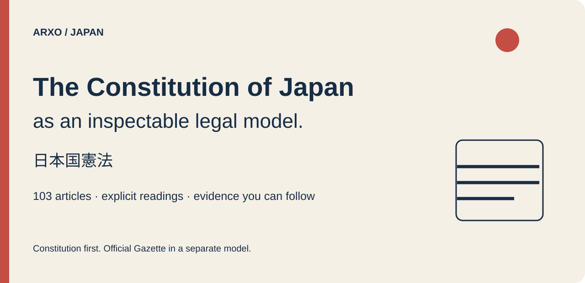
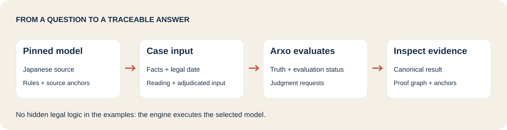
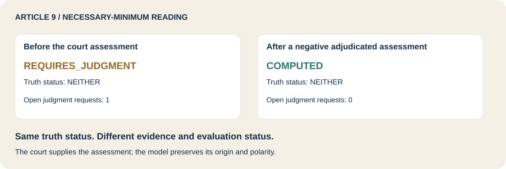
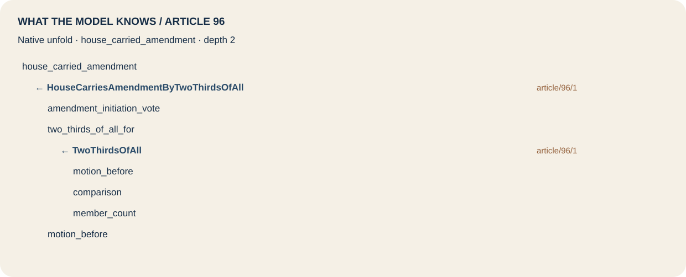

# Arxo Japan

Explore the **Constitution of Japan** through executable questions, explicit facts and inspectable proofs. A separate **Official Gazette (`jp.kanpo`)** model explores what counts as legal publication and when its effects begin.

Japanese sources and statutory labels remain Japanese. Questions and explanations use unofficial English glosses. The models are research demonstrations; source coverage and scenario checks do not establish complete formalization of Japanese law.

[Run a question](#run-a-question) · [Choose a model](#choose-a-model) · [Explore the examples](#explore-the-examples) · [Inspect a proof](#inspect-a-proof) · [Depth and limits](#depth-and-limits) · [Reproduce the checks](#reproduce-the-checks)

## Run a question

Requirements: Python **3.12+**, Git and `curl`. The pinned standalone CLI supports **macOS arm64** and **Linux x86_64**. Downloaded archives are checked against SHA-256 before extraction.

```sh
git clone https://github.com/arxohq/arxo-japan.git
cd arxo-japan
python3.12 tools/install_cli.py --out .toolchain
export LAW_BIN="$PWD/.toolchain/law"
python3.12 tools/example.py amendment-eight-of-twelve
```

This example asks whether eight votes out of **all twelve members** of a House meet Article 96's initiation threshold. The House-level answer is `COMPUTED TRUE_ONLY`. It does not establish approval by both Houses, referendum ratification or promulgation.

Try the boundary:

```sh
python3.12 tools/example.py amendment-seven-of-twelve
```

The answer is `COMPUTED NEITHER`: the positive conclusion is not established. Absence of a positive conclusion is not an explicit negative fact.

The repository uses the standalone **`0.2.3-japan.1` CLI candidate**, with a narrow fix for reference-valued judgment authorities. CLI 0.2.2 refuses the original Constitution world with `CONSTANT_OUTSIDE_MODEL`; [the compatibility report](reports/verification.json) records that regression and its checks. Model sources retain their original version **0.1.0** and semantics **`law.core/0.2.11`**. The CLI candidate is distributed separately; no canon npm package is required.

## Choose a model

| Model | Start here | What it demonstrates |
|---|---|---|
| **`jp.constitution@0.1.0`** | [Constitution sources and rules](packages/constitution) | Voting thresholds, rights and duties, institutional powers, dates, competing readings and external judgment channels |
| **`jp.kanpo@0.1.0`** | [Official Gazette sources and rules](packages/kanpo) | Electronic and paper publication, commencement, inspection periods, disruptions, recovery and retention |

Both models are independent: `jp.kanpo` is not an import of the Constitution, and the Constitution is not an import of `jp.kanpo`. The e-Gov Constitution witness in `jp.kanpo` illustrates why a database copy does not become an Official Gazette publication.



## Explore the examples

Every example includes the **complete [case input](examples)**, canonical query and saved result. Inputs are lowered from existing `.lawtest` scenarios by the CLI, preserving dates, facts, polarity, origins and selected readings. The Python runner only assembles the evaluation request; it implements no legal formulas or thresholds.

| Example | Question | Recorded answer |
|---|---|---|
| [`amendment-eight-of-twelve`](examples/amendment-eight-of-twelve) | Does 8/12 satisfy the Article 96 House threshold? | `COMPUTED` / `TRUE_ONLY` |
| [`amendment-seven-of-twelve`](examples/amendment-seven-of-twelve) | What happens immediately below that threshold? | `COMPUTED` / `NEITHER` |
| [`referendum-three-to-two`](examples/referendum-three-to-two) | Does a 3-to-2 referendum majority approve the amendment? | `COMPUTED` / `TRUE_ONLY` |
| [`article9-literal`](examples/article9-literal) | What follows under the literal pacifist reading? | `COMPUTED` / `TRUE_ONLY` |
| [`article9-judgment-missing`](examples/article9-judgment-missing) | What still needs a court's assessment under the necessary-minimum reading? | `REQUIRES_JUDGMENT` / `NEITHER` |
| [`article9-judgment-negative`](examples/article9-judgment-negative) | What changes with an adjudicated negative assessment? | `COMPUTED` / `NEITHER` |
| [`article9-no-reading`](examples/article9-no-reading) | What follows when no competing reading is selected? | `COMPUTED` / `NEITHER` |
| [`electronic-promulgation`](examples/electronic-promulgation) | Was the instrument promulgated on the inspection-measure date? | `COMPUTED` / `TRUE_ONLY` |
| [`database-copy`](examples/database-copy) | Does an ordinary database copy count as 官報? | `COMPUTED` / `NEITHER` |
| [`retention-awaits-judgment`](examples/retention-awaits-judgment) | Which retention assessments still belong to the Prime Minister? | `REQUIRES_JUDGMENT` / `TRUE_ONLY` |

```sh
python3.12 tools/example.py article9-judgment-missing
python3.12 tools/example.py electronic-promulgation
python3.12 tools/example.py retention-awaits-judgment --json
```

Truth and evaluation status answer different questions. `TRUE_ONLY`, `FALSE_ONLY`, `BOTH` and `NEITHER` retain positive evidence, negative evidence, conflict and absence separately. `REQUIRES_JUDGMENT` names an unresolved assessment and its declared authority; it must not be reduced to a Boolean.



## Inspect a proof

Full JSON includes the canonical result hash, source anchors, judgment requests and `proofGraph`:

```sh
python3.12 tools/example.py amendment-eight-of-twelve --json
```

To inspect the model's reasoning structure independently of a particular case:

```sh
"$LAW_BIN" engine unfold registry/jp-constitution.lawir.json \
  house_carried_amendment --depth 2 --lang en --json
```

<details>
<summary>Open the native Article 96 unfold tree</summary>



This figure is rendered from the CLI's native [unfold document](assets/unfold-amendment.json), not a separately implemented rule. An unfold tree describes potential derivations; the case's proof graph records the actual evaluation.

</details>

## Official Gazette: `jp.kanpo`

The model follows the issuance Act and related regulations from **1 April 2025**. Electronic promulgation follows the legally relevant inspection measure. Paper publication during disruption follows posting; ordinary web posting or an e-Gov copy is not silently promoted to legal publication.

For authored cases preserve `deadline_policy KANPO_INSPECTION_PERIOD`. Omitting it makes relevant evaluation non-executable. Administrative holidays are **explicit case facts**; this model does not supply a national holiday calendar. Time is modeled at **Date** granularity: the 08:30 source label is not an Instant-precision calculation.

Retention includes external judgments. An answer can contain a positive institutional conclusion while evaluation still requires assessments of privacy or special impediments. The model does not create deontic positions for the Prime Minister.

[Browse Kanpo questions and boundaries](packages/kanpo/analysis/questions.ru.md) · [Detailed original package notes](packages/kanpo/README.ru.md)

## Depth and limits

| Dimension | Constitution | Official Gazette |
|---|---|---|
| Source scope | Preamble + all **103 articles**, 176 paragraph fragments, one pinned Japanese edition | Selected issuance Act, Cabinet Order 309 and Cabinet Office Ordinance 80 provisions; separate sources |
| Article-level structural depth | **102 EXECUTABLE**, **1 ANCHORED**, denominator **103**, convention `ja_article` | `not_measured`: the supplied sources have no pinned division declaration; no percentage inferred |
| Rules / norm templates | **554 / 221** | **44 / 0**; institutional conclusions, no deontic positions |
| Interpretations / judgment relations | **6 / 27** | **0 / 4**; Prime Minister assessment channels |
| Fresh CLI checks | **2292 / 2292** on the pinned candidate | **48 / 48** on the pinned candidate |

The [per-unit depth report](reports/formalization-depth.json) uses the existing `boundaries.depth` classifier on each package's own CLIR. `EXECUTABLE` means a derivation rule references that article. It does **not** mean every disposition, legal context or factual boundary of the article is completely executable. The preamble is retained but outside the 103-article denominator. Japanese and English editions are not interchangeable: no English translation is pinned here.

The Constitution's [detailed boundaries](packages/constitution/QUESTIONS.md) include explicit recess-day facts; an `assessment_date` case fact that must agree with `legalTime`; a finite Article 79 review ladder; limitations of power-position publication, Cabinet competence after resignation and partial nullity. Competing readings remain explicit modeling choices, not certified conclusions about disputed constitutional law. An authority's assessment remains input with `origin adjudicated`; the engine does not invent the court's decision.

The original package README records **2292 scenarios under historical dual-evaluator verification**. Fresh CLI runs are distinct evidence; no historical acceptance is transferred automatically to a new engine. The full corpus is **`not_checked`** and overall release acceptance is **`releaseVerified: false`**.

## Reproduce the checks

```sh
python3.12 tools/check.py --package constitution
python3.12 tools/check.py --package kanpo
```

These commands verify source and delivery hashes, test only the selected package in an isolated temporary directory, and replay its examples twice against the saved canonical document. No full corpus is discovered or executed. [Verification report](reports/verification.json) · [Source pin](source-pin.json) · [Exact publication inventory](CANON-MANIFEST.json) · [Delivery and provenance](docs/DELIVERY.md)

`packages/` contains readable model sources and scenarios. `registry/` contains freshly lowered standalone CLIR. `examples/` holds complete reader inputs and answers. `assets/` contains native SVG visuals. Tool downloads and runtime caches remain outside the publication inventory.

## Sources and license

Arxo-authored model code, tools and original documentation: **Apache-2.0**. Source legal texts and provenance are identified in [NOTICE](NOTICE). The Constitution and legislation are excluded from copyright protection by [Article 13 of Japan's Copyright Act](https://laws.e-gov.go.jp/law/345AC0000000048); that statement does not apply to all government-site material.

Official source: [e-Gov Law Search](https://laws.e-gov.go.jp/law/321CONSTITUTION). These are pinned copies and executable interpretations, not authenticated 官報 publications or official English translations.
